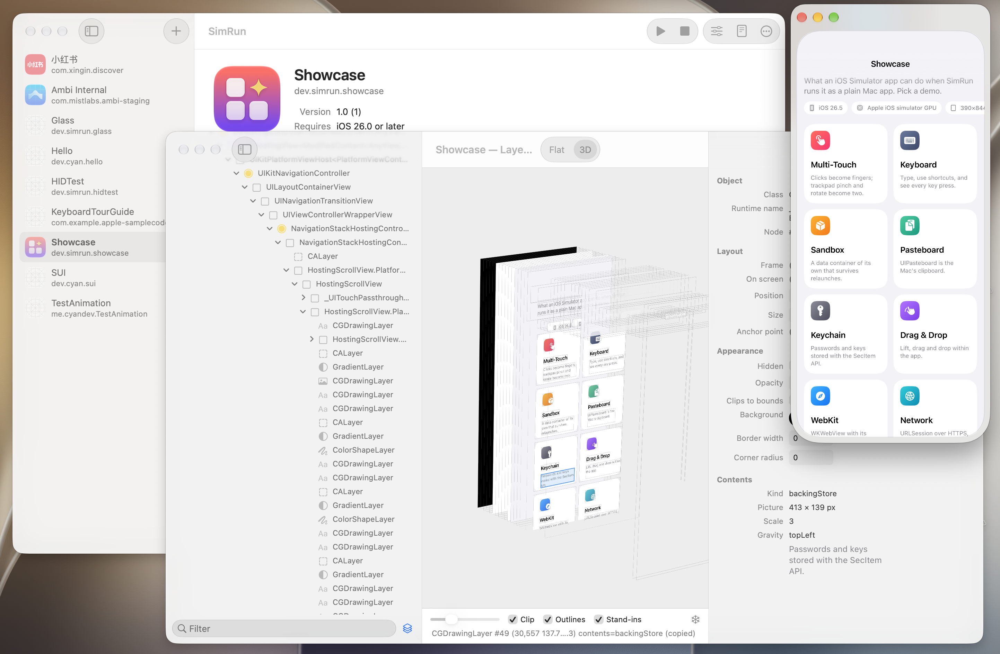

# SimRun



SimRun runs iPhone apps on your Mac, each in its own ordinary Mac window.

It takes the app you already build for the iOS Simulator in Xcode, unchanged, and starts it directly. There is no simulated iPhone to boot, no home screen, no device frame: just your app, in a
window, controlled with your mouse, trackpad and keyboard.

> SimRun is an experimental research project. It's useful for day-to-day work on an app's UI, but it is not a
> replacement for testing in the Simulator or on a real device.

## Why not just use the Simulator, or Mac Catalyst?

**Compared with the iOS Simulator**

- **Nothing to boot.** The Simulator starts a whole virtual iPhone before your app can run. SimRun starts only your
  app, so it's on screen in about half a second.
- **Lighter.** None of the simulated phone's background system runs. Only your app and a few small helpers do.
- **Apps are real windows.** Every app gets its own Mac window. Put several apps side by side, resize them, or
  minimize them like any other window.
- **Your trackpad works naturally.** Two-finger scrolling, pinch to zoom and rotate gestures turn into real
  multi-touch input. No Option-dragging to fake a second finger.
- **Fits into the terminal.** Launch an app from the command line and its output prints right there. When the app
  exits, the command exits with the same status, which is handy in scripts.
- **Easy to look inside.** One click opens an app's data folder in Finder or wipes it, and a Keychain window shows
  everything apps have saved there, passwords included.

**Compared with Mac Catalyst**

- **No porting.** Catalyst means making a Mac version of your app: a new build target, Mac-specific code paths, and
  APIs that behave differently. SimRun runs the iOS Simulator build you already have.
- **Looks and behaves like the iPhone version.** Your app runs with the iPhone's own UIKit and SwiftUI, so layouts,
  controls and Liquid Glass look the way they do on a phone, not the way they're adapted for the Mac.
- **Works with apps you didn't write.** Any iOS Simulator build can be opened, including ones you received from
  someone else, without access to the source.

## What you need

- A Mac with Apple silicon
- Xcode, with an iOS Simulator runtime installed (SimRun uses the newest one it finds; pick another in SimRun ▸ iOS
  Runtime, or for one app with Launch With…)
- System Integrity Protection (SIP) turned off. SimRun needs to load its own code into iOS apps, which macOS only
  allows with SIP off. Apple describes how to change this setting in
  [Disabling and Enabling System Integrity Protection](https://developer.apple.com/documentation/security/disabling-and-enabling-system-integrity-protection).

SimRun is developed on macOS 27.2 with Xcode 27.1 and the iOS 27.1 runtime; the iOS 27.0, 26.5 and 18.6 runtimes work too.
Other versions may or may not work.

## Build

```bash
make
```

This builds `build/SimRun.app`. You can rebuild while SimRun is open; quit and reopen SimRun to pick up the new
version.

To also build the sample apps into `build/apps/`, including Showcase, a tour of what SimRun can do:

```bash
make test-apps
```

## Use

### With the SimRun app

```bash
open build/SimRun.app
```

SimRun opens a launcher window listing your apps. To add one, do any of the following:

- Drag an iOS Simulator `.app` onto the launcher window or onto SimRun's Dock icon.
- Choose **File ▸ Add App…**
- Choose **File ▸ Add Xcode Simulator Builds** to add everything you've built for the Simulator in Xcode.
- In Finder, right-click an app and choose **Open With ▸ SimRun**.

SimRun remembers the list. Double-click an app to launch it. While it starts, its row shows a spinner; once the
window is up, the row shows a green dot.

To see what SimRun can do, build the sample apps (`make test-apps`), then add `build/apps/Showcase.app` and launch it.

How your Mac maps to an iPhone:

- **Click and drag** is a tap and a finger drag.
- **Two-finger scroll** on a trackpad is a swipe that keeps scrolling with momentum when you let go.
- **Pinch** and **rotate** on a trackpad are two-finger pinch and rotate. A **two-finger double tap** is a double tap.
- **Typing** goes to whichever text field has focus, as if a hardware keyboard were connected.
- **Copy and paste** use your Mac's clipboard, so you can copy in an app and paste in any Mac app, and the other way
  round.

### From the terminal

```bash
scripts/simapp.sh build/apps/Showcase.app
```

The app opens in a window, and its output appears in your terminal. Press Ctrl-C or close the window to quit it.
Anything after the app's path is passed to the app as launch arguments.

If SimRun isn't open, this starts it in the background without the launcher. It quits by itself after 10 minutes
with no apps running.

## Tips

- **Your app keeps its data between launches**, just like on a phone. To start fresh, right-click the app in the
  launcher and choose **App Container ▸ Reset…**. **App Container ▸ Show in Finder** opens its Documents, Library
  and tmp folders.
- **Check what an app saved in the keychain** with **Window ▸ Keychain** (⇧⌘K). Right-click an app in the launcher
  and choose **Show Keychain Items** to see only that app's items.
- **Apps follow your Mac's language and region settings**: language, date and number formats, 24-hour time, and
  the first day of the week.
- **Run as a different iPhone or iPad**: hold ⌥ in the app's menu, choose **Launch With…** and pick a **Device**. You
  can choose any device type the app's runtime supports. The app gets that model's screen size, safe areas and
  features such as the Dynamic Island. From the terminal, set `SIMRUN_DEVICE`:

  ```bash
  SIMRUN_DEVICE="iPhone SE (3rd generation)" scripts/simapp.sh path/to/MyApp.app
  ```

  The default is the runtime's 6.3-inch iPhone Pro (402 × 874), or its newest iPhone if it has none. Resizing a
  window only scales the picture; it doesn't change the screen size the app sees.
- **See your app's `NSLog` and `os_log` messages** in the terminal by adding `OS_ACTIVITY_DT_MODE=1` before
  `scripts/simapp.sh`.
- **Manage the background SimRun** with `scripts/simrund.sh status`, `scripts/simrund.sh stop` and
  `scripts/simrund.sh log`. The log is the first place to look when an app fails to start.
- **Run an app on its own**, isolated from other apps, with `SIMAPP_STANDALONE=1 scripts/simapp.sh …`.

There are many more settings for troubleshooting and debugging. See [Configuration and reference](docs/reference.md).

## Known limitations

- **Only apps that use scenes.** Apps must use the scene-based life cycle (`UIScene`, or any SwiftUI `App`). Older
  apps built only around an app delegate won't show a window.
- **No on-screen keyboard.** Type with your Mac's keyboard. Keys are read by position as a US layout, so some
  characters may come out differently on other keyboard layouts.
- **The first time you tap into a text field, the app may freeze for 2–3 seconds.** It's fine after that.
- **Portrait only.** There's no way to turn an app sideways yet, and apps aren't told about device orientation.
- **No sound.**
- **Background apps keep running.** Apps never get suspended the way they would on a phone.
- **Drag and drop only works within one app**, not between apps or between an app and the Mac.
- **The keychain isn't secure.** Everything is stored unencrypted, and nothing ever asks for Face ID or a passcode.
- **Some web features are missing.** Web views work, but `SFSafariViewController` and
  `ASWebAuthenticationSession` (used for "Sign in with…" flows) don't.
- **Apps aren't sandboxed.** They run with your user account's full access to your files.
- **Quitting is abrupt.** Apps are stopped without running their termination code.
- **Untested:** app extensions (widgets, share extensions and so on) and apps that bundle their own frameworks.

The [technical notes](docs/reference.md#known-gaps) have the details.

## Learn more

The [docs](docs/README.md) explain how SimRun works, how the project is organized, and how each part was built.

## License

SimRun is available under the [MIT License](LICENSE).
